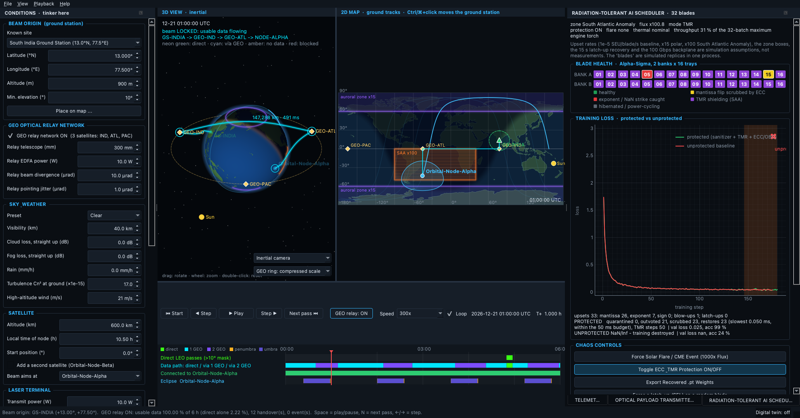

# satSTK — Orbital Mission & Laser Link Simulator

*satSTK* is the mission-analysis companion to [satCAD](https://github.com/Saiaarjay09/satCAD): satCAD designs the spacecraft, satSTK simulates its orbit, eclipses and laser link.

A laser **ground station at one fixed place** (default: **GS-INDIA, 13.0° N, 77.5° E**) sends a **1550 nm beam to a satellite** (**Orbital-Node-Alpha**, a 600 km Sun-synchronous orbital AI datacentre node).
Straight from the ground, a low-Earth satellite is above the horizon for only about **18 minutes a day** from there (1.25 % of the time with usable data). So satSTK 2.0 adds a
**geostationary optical relay network**: three GEO satellites (**GEO-IND**, **GEO-ATL**, **GEO-PAC**) acting as laser "bent pipes", with a router that switches between the direct beam and
2-hop / 3-hop relay paths every few seconds. In clear sky the data link is **up 100 % of the day**; switch the relay OFF (one button) and you see the 1.25 % direct-only figure.

**New in 2.1:** you can **fire a real payload through it**. A text message or any file (or the built-in 63 KB self-checking test file) is modulated (BPSK / QPSK / 8PSK / 16QAM, IQ Mach-Zehnder modulator),
sent hop by hop over whichever route the simulation has at that moment, with that route's real ranges, atmosphere, events and pointing jitter, acquired by a spiral-search + Fast-Steering-Mirror receiver, demodulated, and
checked against its CRC-32. A streaming mode sends a big file frame by frame while the satellite moves and the route hands over from direct LEO to the GEO relays.

**New in 2.3:** a **Radiation-Tolerant AI Scheduler**. The Alpha-Sigma orbital datacentre (a 1:1 satCAD design: 2 banks × 16 server trays) trains a real neural network across its 32 blades while the satellite's live position drives cosmic-ray bit flips: 15× more over the polar horns, 100× over the South Atlantic Anomaly. See [Radiation-tolerant AI scheduler](#radiation-tolerant-ai-scheduler-new-in-23).

On top of that: a **Conditions panel** to tinker with almost everything (live recompute), weather and turbulence in the atmosphere, and **random and rare events** (birds, aircraft, storms, earthquakes ...).
It runs natively on **macOS and Linux** (and as an app on Windows), needs **no Ansys STK, no licence, no Windows COM, no internet and no account**, and stores nothing unless you export a CSV.

> **What was Orbital-Node-Beta?** A second LEO satellite from the earliest versions. It is now optional: tick *Add a second satellite* in the Conditions panel to get a second target (the beam, and the relay routing, can aim at either), plus a computed crosslink between the two.


*(Screenshot rendered by the app itself with `--screenshot`.)*

## Download the app (no Python needed)

The **Releases** page has a `.dmg` for Apple-silicon Macs (drag satSTK into Applications) and a `-setup.exe` installer for 64-bit Windows 10/11. The apps are
unsigned, so the first launch shows a warning: on a Mac use **System Settings → Privacy & Security → Open Anyway**; on Windows press **More info → Run anyway**.
The macOS app was tested on a real Mac; the Windows installer is built and smoke-tested by GitHub Actions but has not been run on a real PC by the author.

## Run it from source (macOS)

You need Python 3.10 or newer (`python3 --version` to check; get it from python.org if missing). Then, in Terminal, from this folder:

```bash
python3 -m venv venv
```
```bash
source venv/bin/activate
```
```bash
pip install -r requirements.txt
```

and launch the app with the single command:

```bash
python main_app.py
```

Next time you only need `source venv/bin/activate` and `python main_app.py` (or just `./run.sh`, which does all of it for you).
Linux is the same. Windows should work with `venv\Scripts\activate` but has **not been tried**.

## How to use it

1. **Place the beam origin.** On launch a map opens: click where the ground station stands (or pick a known site, including the South India station, or type coordinates) and press **Start simulation**. Later: *File → Place ground station*, or **Ctrl/⌘+click** the 2D map.
2. **Watch it.** Press Play (Space). **Next pass** (N) jumps to just before the next *direct* LEO pass.
3. **Compare architectures.** The **GEO relay: ON/OFF** switch in the transport bar (also a checkbox in the Conditions panel) recomputes everything. Look at *Contact uptime* and *Data transferred* in the telemetry: ON gives 100.000 %, OFF gives the direct-only figure.
4. **Tinker.** The Conditions panel on the left changes the sky, laser, relay terminals, satellite and time; with *Live update* ticked everything recomputes half a second after you stop typing.
5. **Break things.** Tick *Random events on*, slide the frequency (×0.1 to ×1000), *Re-roll* the seed, or open *Choose events / add one by hand*.

## The GEO relay network (new in 2.0)

**The ring.** Three geostationary satellites on the equator (0° inclination, 35,786 km up, one orbit per sidereal day = 23 h 56 min 04 s, so each hangs at a fixed longitude):

| Relay | Longitude | Role |
|---|---|---|
| `GEO-Relay-IND` | 77.5° E | Indian Ocean anchor: directly south of GS-INDIA, **74.7° elevation, 35,976 km, always visible** |
| `GEO-Relay-ATL` | 45° W (315° E) | Atlantic: sees the LEO node when it is over the western hemisphere |
| `GEO-Relay-PAC` | 165° W (195° E) | Pacific: completes global coverage of the 600 km shell |

They are about 120° apart; every pair has a clear line of sight (the beam clears the Earth by more than 10,000 km), and together the three see **every point of the 600 km shell** (checked on 40,000 random positions including the poles); one relay alone sees only about half of it.

**The router.** At every time step it picks a path, in this order of priority:

1. **Direct LEO link** — ground → satellite while the satellite is above the station's mask (10° by default) and carries usable data. Latency a few ms.
2. **2-hop relay** — ground → GEO relay → satellite, when the satellite is below the horizon but a relay can see it (the Indian Ocean relay is used while it can see the satellite). Latency ≈ 240–270 ms.
3. **3-hop relay** — ground → GEO-IND → GEO-ATL *or* GEO-PAC → satellite, when the satellite is on the far side of the Earth from GEO-IND. Latency ≈ 480–510 ms.

Among paths of the same priority the shortest wins; if no path carries data but one exists geometrically it is still chosen and shown as *degraded* (amber). **Make-before-break:** a handover is called *hitless* if the new path was already lit before the old one went dark (or the old one stays lit). In clear sky all handovers are hitless, because GEO-IND is always up. Each handover changes the latency by up to ~500 ms (packets may re-order); the model does not simulate that.

**The link budget on the relay hops.** The relay terminals use **300 mm telescopes, 10 W erbium-doped fibre amplifiers (EDFAs) and narrow 10 µrad beams** (1 µrad pointing jitter), because the hops are 35,000–44,000 km (free-space loss ≈ 289 dB at 36,000 km). Each hop is budgeted separately; the relays are **bent pipes**, so noise is amplified along with the signal and the end-to-end SNR is `1/SNR = Σ 1/SNR_hop` (the weakest hop dominates). The ground hop includes the atmosphere (haze, cloud, turbulence, events), at its own elevation (74.7° for GEO-IND). Doppler uses the rate of change of the whole path.

**What "error-free" means here.** At the default **250 Gbaud** the relay paths close at an SNR of 9–9.6 dB (2 hops, QPSK) and 6.4–6.7 dB (3 hops, BPSK): a *raw* BER of about 1–2×10⁻³, corrected to clean data by the 7 % FEC (modelled as a threshold: usable if the raw BER is below 3.8×10⁻³; no decoder is simulated). If you want the raw BER itself to be negligible, slow down: **at 50 Gbaud, BPSK has a raw BER below 10⁻⁹ on every path** (tested). The GEO relay budget needs the narrow beam — with the LEO terminal's 100 µrad beam it would lose 20 dB.

**What 100 % does and does not mean.** It is 100 % of the time in clear sky with no events: the geometry never blocks every path. It is **not** immune to weather over the ground station (every path starts in the same air: an *Overcast* sky, 25 dB of cloud, takes the relay uptime to ~0 %), nor to satellite-side faults or station-side events (they are applied to every path). A thin cirrus layer, by contrast, barely dents the relay uptime while ruining the direct beam.

## The optical payload transmitter (new in 2.1)

The **OPTICAL PAYLOAD TRANSMITTER** dock (a tab next to the Telemetry dock; *View* menu) connects satSTK's orbital geometry to a symbol-level optical physical layer (the `dsp/` package, migrated from the three-module Orbital-Datacentre simulator: transmitter, channel, receiver).

**Use it:** move the clock to any moment (or pick a specific route in the dock: *Direct LEO*, *2-hop via GEO-IND*, or *3-hop via GEO-IND and GEO-ATL/PAC*; routes without line of sight right now are marked ✗), type text or *Browse file ...* or press **Generate 63 KB Test Payload**, choose the modulation and hardware, and press **🔥 Fire Laser Payload**.

| Control | What it does |
|---|---|
| Payload | Typed text, any file up to 128 KB, or the generated test payload: **1,008 self-checking 64-byte ASCII lines (63 KB = 64,512 bytes)**; every line carries its own CRC-32, so a damaged block can be located (the dock reports "blocks bad: n of 1008"). *Save payload ...* writes it to disk (e.g. as `test_payload_63kb.txt`). |
| Modulation | `BPSK`, `QPSK`, `8PSK`, `16QAM`, or **Auto-Adaptive**: it predicts the end-to-end Es/N0 of the chosen route from the live geometry and picks the densest scheme whose expected number of bit errors in the frame is below 0.02 (after a 3 dB safety margin), so the CRC should pass. Faster symbols or longer routes get sparser modulation; if even BPSK is predicted to fail, it says so. |
| Symbol rate, laser power, beacon power | Default 10 Gbaud, the scenario's 10 W, 1 W beacon. |
| FSM closed-loop ON/OFF | ON: the receiver's PI-controlled Fast Steering Mirror pulls the beam onto the sensor centre. OFF: no tracking: the 300 µrad platform pointing error leaves almost no light in the fibre and nothing is received (this is why PAT exists). |
| Continuous file stream | Slices the payload into frames (default 1 KB) and sends frame *k* at start + (k + 0.5)/n × the chosen simulated duration, over whatever route is in force at that time, re-choosing the modulation per frame in Auto mode. |

**What happens when you fire:** framing (length + CRC-32) → Gray-mapped symbols → root-raised-cosine pulses → IQ Mach-Zehnder modulator → **hop 1** leaves the ground station through the atmosphere (haze, cloud, one frozen turbulence fade, any events) and its vacuum channel (Gaussian beam, the hop's real range, pointing jitter, laser phase noise) → at each **GEO relay** the beam is received (adding the relay's receiver noise) and amplified back to 10 W by the EDFA → the next hop with its own range → the satellite's terminal runs **PAT**: spiral beacon search over a quadrant detector, detection, PI tracking, lock → matched filter, preamble sync, decision-directed carrier PLL → de-framing and **CRC-32**.

**What you see:**
* **Constellation**: the received I/Q symbols over the ideal points (dispersion = SNR, rotation/streaking = phase noise).
* **FSM / PAT**: the beam position on the quadrant detector in µrad: amber spiral search, then the green PI-controlled track onto (0, 0), plus the PAT event log with time to detect and lock.
* **Payload diff**: transmitted and recovered side by side (text or hex), wrong bytes in red.
* **Stream log**: one row per frame (time, route, modulation, BER, OK/LOST, handover and whether it was hitless), a plot of modulation order over the orbit with handover lines, and a summary.
* **Details**: CRC-32 badge, route, modulation (and why), receiver BER against the sent bits, exact bytes wrong and %, 64-byte blocks bad, **frame loss %**, **end-to-end latency** (light time over every hop + frame serialisation + relay processing; PAT time-to-lock shown separately), Es/N0 predicted and measured, received power.

**Where the numbers come from (and are checked):** every hop's range, aperture, power, beam width, jitter, atmosphere loss and event effects come from the simulation's own configuration; satSTK's analytic end-to-end Es/N0 and the DSP chain's predicted Es/N0 agree to 0.001 dB on every route type, hop-by-hop power budgets agree to 0.02 dB, and the DSP channel's oracle BER matches the textbook BER (2.03×10⁻³ measured vs 1.99×10⁻³ theory at 9 dB). Typical results at 10 Gbaud: the 63 KB payload passes the CRC on every route in about a second (Auto picks 16QAM on the direct beam, 8PSK to 16QAM through one relay and QPSK through two); stream it from 30 minutes before a direct pass for an hour (`--stream`) and all 63 frames arrive across the GEO → direct → GEO handovers.

**Why 10 Gbaud and not 250?** The simulation's 250 Gbaud budget assumes a 7 % FEC threshold (raw BER ~10⁻³ is "fine"). This DSP has no FEC: one wrong bit fails the CRC, and a real receiver (PAT residual, carrier loop) performs about 3 dB worse than textbook theory (it is measured, not assumed). At 250 Gbaud a 63 KB frame cannot get through the GEO paths (the tests check this), so the default is 10 Gbaud; raise it and watch Auto-Adaptive step down, then BPSK fail.

Command line (no window): `python main_app.py --send-text "hello" --at-hours 0.7`, `--send-file data.bin`, `--send-test-payload --mod 16QAM` (add `--route N` to force a route by the number listed in the dock; it reports if that route has no line of sight at that time), `--no-fsm`, `--dsp-rate 40`, and `--send-test-payload --stream --at-hours 4.4 --stream-minutes 60 --frame-bytes 1024`.

## Radiation-tolerant AI scheduler (new in 2.3)

At 600 km a proton or cosmic ray can flip one bit in a GPU's memory (a **Single-Event Upset, SEU**). Open the **RADIATION-TOLERANT AI SCHEDULER** tab (beside Telemetry and Optical Payload) and press Play: a small neural network trains across the **32 blades** of the Alpha-Sigma datacentre (Bank A = blades 1–16, Bank B = 17–32) while upsets are injected according to where the satellite is. A second, **unprotected** copy of the same system suffers the *identical* upsets, so you can watch what the protection buys.



*(Rendered by the app: `python main_app.py --screenshot shot.png --show-radiation --at-hours 1.0 --rad-minutes 120`. Here the unprotected line went NaN inside the South Atlantic Anomaly (shaded) while the protected line kept converging.)*

**How to use it.** Press Play (or step the clock). Watch the blade grid, the loss chart and the SAA / auroral glow on the 2D map and 3D globe. The chaos buttons:

| Control | What it does |
|---|---|
| **Force Solar Flare / CME Event (1000x Flux)** | Multiplies the flux 1000-fold everywhere until you click it again. The unprotected baseline dies within a few steps; the protected system keeps learning. |
| **Toggle ECC & TMR Protection ON/OFF** | Turns the sanitizer, TMR, ECC parity and OBC checkpointing off for the *protected* line; it then suffers the same fate as the baseline. |
| **Export Recovered .pt Weights** | Saves the OBC-verified weights (a PyTorch `.pt` file; a NumPy `.npz` if torch is not installed) and, if ticked, loads the file into the **Optical Payload dock as 16QAM and fires it** through the existing laser downlink (`optical_dsp_bridge.py`). |
| Force a latch-up / Simulate a hot core / Restart training | Extra demo switches (not in the brief): a Single-Event Latchup on a random blade; +35 °C on the core temperature so it reaches soft throttle; start training over. |

**Blade colours:** green = healthy · **yellow flash** = a mantissa flip scrubbed by ECC · **red flash** = an exponent (NaN-class) strike caught and quarantined or scrubbed · **purple** = TMR shielding active · **grey** = hibernated (thermal soft throttle) or power-cycling after a latch-up.

### The SAA radiation model

`seu_injector.py` ties the upset rate to the satellite's live latitude, longitude and altitude:

```
rate per blade = λ_base × zone multiplier × altitude factor × flare factor       λ_base = 1e-5 upsets per blade per second
zone:  nominal LEO 1×   ·   polar horns (|lat| > 60°) 15×   ·   South Atlantic Anomaly (lat −50…0°, lon −90…+40°) 100×
```

The altitude factor is `exp((alt − 600 km)/300 km)` clipped to 0.25…4 (1.0 at 600 km), and the flare factor is 1 or 1000. Upsets in a step are drawn from a Poisson distribution with mean `rate × dt`. About 70 % land in the blade's resident weights and 30 % in the gradient it is computing (assumption). A rare **Single-Event Latchup** (1 per 500 upsets) takes the whole blade offline for 15 s until the 48 V busbar breaker power-cycles its tray (its memory is wiped).

### IEEE-754 bit-flip injection

A float32 is 32 bits: **1 sign bit (31), 8 exponent bits (30…23), 23 mantissa bits (22…0)**. `inject_ieee754_bitflip(tensor)` views the tensor's memory as raw `uint32` (`uint16` for bfloat16 / float16, `uint64` for float64) and flips one random bit with XOR:

```
raw[i] ^= (1 << bit)
```

and reports the field that was hit and its effect:

| Field | Share of random hits (float32) | Effect |
|---|---|---|
| Mantissa (bits 0–22) | 72 % | Tiny noise. Bit 3 of 0.1 changes it in the 7th digit; even bit 22 only moves 0.1 to 0.069. |
| Sign (bit 31) | 3 % | The weight is inverted (0.1 → −0.1). |
| Exponent (bits 23–30) | 25 % | The value is multiplied by a power of two. **Bit 30 turns 0.1 into 3.4×10³⁷**, and if the exponent becomes all ones the value is **Inf or NaN** (bit 30 of 1.0 gives Inf). One such weight makes the loss NaN and the next update spreads the NaN to every blade that averages it. |

Torch tensors (float32, bfloat16, float16) are flipped in place too, using the signed integer view of the same bits; the tests check that torch and NumPy give the same results.

### The four protection layers

1. **Sanitizer.** Before gradients are averaged, each blade's gradient gets a CRC-32 hash, an L2 norm and an `isnan`/`isinf` test. A gradient that is non-finite, or whose norm is more than **5× the median**, is **quarantined** for that step; the others are averaged without it.
2. **TMR shielding in the SAA.** `orbital_engine`'s ground track is used to *predict* entry into the SAA box 300 s ahead (also when the flux is ≥ 50×, such as during a flare). The system then leaves high-throughput data-parallel mode (32 independent batches) and runs **Triple Modular Redundancy**: 10 triads (5 per bank; blades 16 and 32 are hot spares that replace a triad member that has latched up) compute the *same* batch and a **2-of-3 majority vote on the gradient hashes** picks the answer. A single corrupted member is outvoted; if all three differ the triad's batch is dropped for that step. The price: only 10 distinct batches per step, about 31 % of the throughput.
3. **ECC parity + OBC checkpoint healing.** Every blade's weights carry a per-tensor CRC-32 that is checked each step against the central avionics computer (OBC). The OBC holds a **SHA-256 verified checkpoint** every N = 10 steps (two mirrored copies) plus a journal of the updates since, so it can rebuild its own live copy bit for bit. A blade that fails its parity check gets *only the damaged tensor* restored over the internal optical backplane, modelled as **100 Gbps with 0.05 ms latency (about 0.05 ms for this 10 KB model, against a 50 ms budget)**, while the other 31 blades keep training. A blade that returns from a latch-up or hibernation is restored the same way. *Reed-Solomon was not implemented*: the checkpoint is protected by SHA-256 and a mirror.
4. **Thermal coupling.** The core temperature comes from the cooling-loop model in `thermal_loop.py`. At **75 °C (soft throttle, released at 70 °C)** Bank B (blades 17–32) hibernates and Bank A takes the whole batch (16 blades × 2 micro-batches, half the speed). Note that this workload is not fed back into the thermal model (the model is driven by the waste-heat setting in the Conditions panel), and the 75 °C is this scheduler's own threshold (the digital twin's own throttle is at 85 °C).

### PyTorch or NumPy

`requirements.txt` lists `torch`. When it is installed the training loop is real PyTorch autograd and the blades hold real torch tensors that get bit-flipped. **When it is not, a built-in NumPy engine (hand-written backward pass) does the same job**: the tests check that both engines give the same loss and gradient (to 1e-5) and the same training run, and the whole test suite passes in an environment with no torch. The packaged desktop apps do not include torch (it is gigabytes) and always use the NumPy engine. The workload is a small 3-layer MLP (2,516 weights) classifying four Gaussian clusters, not a language model.

**Command line (no window).** `python radiation_pytorch_scheduler.py --hours 3` runs the orbit, trains protected and unprotected side by side and prints a summary (`--flare`, `--engine numpy|torch`, `--export weights.pt`). For example, three hours with the default seed: 74 bit flips (53 mantissa, 20 exponent, 1 sign), the protected system ends at 99.6 % validation accuracy, the unprotected one goes NaN inside the SAA at step 178.

### What this is and is not

* **The numbers are simulation assumptions, not measurements.** The 1e-5 upsets per blade per second baseline, the 15× and 100× multipliers, the zone boxes, the altitude scale, the 70/30 split between weights and gradients, the 1-in-500 latch-up share, the 15 s power-cycle, the 100 Gbps / 0.05 ms backplane and the 5× norm threshold are the author's placeholders. They are not taken from a flight dataset or a beam test and no hardware fault rate is claimed. The real SAA is not a rectangle.
* **Not flight-qualified.** The 32 "blades" are replicas in one Python process, sharing one clock; there is no real HBM, no real ECC hardware, and TMR here compares gradient hashes of identical deterministic computations.
* **Chance is real.** Every random bit is equally likely, so only about 1 hit in 32 flips bit 30 and one SAA pass can leave the unprotected system alive (in the tests' seeds it usually dies; the **flare** button makes it certain). The protected system never failed in any test, which is evidence, not a guarantee.
* The unprotected twin deliberately has *none* of the protections, which is an extreme baseline; real systems have some ECC in hardware. A power-cycled unprotected blade comes back with zeroed memory (an assumption).
* Only the weights and gradients are upset, not activations, optimizer state or the OBC itself (assumed radiation-hardened).

## Digital Twin with satCAD

While satSTK plays an orbit simulation it can stream live telemetry to **satCAD**, the 3D CAD application, which uses it to articulate the satellite model (solar arrays, laser turrets), colour it by temperature and show a heads-up display. Everything stays on your computer: UDP datagrams to `127.0.0.1` only (the sender refuses any other address). The wire format is defined in satCAD's `docs/TELEMETRY_PROTOCOL.md` (protocol v1).

**Run both on macOS** (two Terminal windows, in either order: neither program waits for the other):

```bash
cd ~/Developer/STK && ./run.sh --broadcast --autoplay --no-placement --speed 60
```

This starts the satSTK window, skips the "place the ground station" dialog, starts playing at 60× (one simulated minute per second) and streams. Then start satCAD in **Digital Twin Listener Mode** (satCAD's README has the exact command and a launcher script). When satCAD is listening, satSTK's status bar changes from "Digital twin: broadcasting to 127.0.0.1:9876, satCAD not connected" to "Digital twin: satCAD connected".

No window needed (real-time, terminal only):

```bash
cd ~/Developer/STK && ./run.sh --headless --broadcast --speed 60
```

prints one status line every two seconds and streams until Ctrl-C (`--wall-seconds 30` stops it after 30 real seconds; `--at-hours 4.8` starts the orbit at a direct pass).

| Flag | Meaning |
|---|---|
| `--broadcast` / `--no-broadcast` | Stream telemetry. The **window streams by default while it plays** (`--no-broadcast` or *Playback → Stream live telemetry to satCAD* turns it off). With `--headless`, `--broadcast` starts the real-time streaming run (without it, `--headless` just prints the summary). |
| `--broadcast-port N` | UDP port to send to on 127.0.0.1 (default 9876). `--status-port N` is the port satSTK listens on for satCAD's status datagrams (default 9877). |
| `--speed X` | Playback speed in simulated seconds per real second (window default 300, headless default 60). |
| `--autoplay` | Start playing as soon as the scenario is computed. |
| `--no-placement` | Use the default ground station instead of opening the placement window (for launchers). |

**How the stream behaves.** 30 packets per **wall-clock** second while playing, whatever the playback speed (measured 30.0 Hz over 8 s on the real window, no lost sequence numbers); one per second while paused. It runs on its own thread, so a busy window cannot slow it, and values are interpolated between the engine's 10-second samples so the twin moves smoothly. The sender never blocks or raises if nobody is listening. Packets are about 470 bytes.

**For a launcher** (satCAD's "start the twin" button): find the satSTK folder in the environment variable **`SATSTK_HOME`** (default `~/Developer/STK`) and run `"$SATSTK_HOME/run.sh" --broadcast --autoplay --no-placement --speed 60`. `run.sh` creates the virtual environment and installs the requirements the first time.

**Frames and angles** (both programs use these):
* Body frame = LVLH: **+Z along the velocity vector, +Y radial outward (zenith), +X = Y × Z = the orbit normal.**
* `sun_vector_body_deg` = `atan2(sun_z, sun_y)` mod 360 in that frame: 0 = Sun at zenith, 90 = Sun ahead. It is the Solar Array Drive rotation about +X.
* Turret pointing: for the unit direction **d** to the target in the body frame and a turret with outward normal (0, 0, s) (s = +1 forward `fwd_*`, −1 aft `aft_*`): `elevation = asin(s·d_z)`, `azimuth = s·atan2(−d_x, d_y)` (0 = the +Y home boresight), wrapped to ±180°. The active turret is `fwd_a` if the target is in the forward hemisphere (d_z ≥ 0), else `aft_a`.
* `active_relay_id` is what the satellite's laser terminal is locked to in the routing: `SOUTH-INDIA-GS` on a direct pass, otherwise the relay at the satellite's end of the route (`GEO-RELAY-IND`, `-ATL`, `-PAC`), `NONE` when no route carries the beam. (`SOUTH-INDIA-GS` is the protocol's fixed name for the ground station, whatever place you chose.)

**What is computed and what is modelled**

| Field | Source |
|---|---|
| `timestamp_utc`, `sun_vector_body_deg`, turret `azimuth` / `elevation`, `active_relay_id` | **Computed** by the engines: orbit propagation, Sun position, ground-station and relay geometry, and the router's choice at that moment. |
| `radiator_temp_c` | **Computed** by the radiator engine (waste heat + absorbed sunlight + eclipse), then smoothed by a 15-minute thermal-mass lag so it does not jump at eclipse edges. |
| `core_temp_c`, `coolant_flow_lpm`, `bypass_valve_pct`, `throttle_mode` | **Modelled** (`thermal_loop.py`) with **placeholder parameters**, not data about a real vehicle: a lumped core with a cold-plate resistance, a pump that follows the heat load, a bypass valve that keeps the coolant above 18 °C, throttling at 85 °C (back to nominal below 80) and shutdown at 95 °C. With the default 10 kW the core sits at about 41–60 °C; raise *Waste heat* to about 15 kW in the Conditions panel (or shrink the radiator) and it passes 85 °C and throttles. |
| `modulation`, `snr_db`, `ber`, `throughput_gbps` | **Computed** from the simulation's end-to-end link budget for the current route (the best modulation that clears the FEC threshold). These are *not* the symbol-level DSP results: the DSP chain (payload transmitter dock) is far too heavy to run 30 times a second and uses a different symbol rate. |
| `fsm_x_urad`, `fsm_y_urad` | **Assumed**: half of the DSP receiver's default angle-of-arrival disturbance (250 / −180 µrad offset, 15 µrad rms jitter), i.e. where a tracking mirror would sit, with fresh random jitter every packet; zero when there is no lock. |

**Not verified:** I checked that the real satCAD parser (run in satCAD's own environment) accepts the packets and that the UDP round trip works over loopback; I have not watched the satCAD 3D window respond. The 30 Hz figure was measured on one Mac; Windows and Linux are untested for this feature.

## What you see

| Pane | What it shows |
|---|---|
| **3D view** | Shaded globe, orbit, the satellite, the **GEO ring (35,786 km) with the three relays**, the ground station and the active beam path: **neon green = direct LEO pass, bright cyan = via GEO relay(s), amber = on the satellite but no usable data, red dashed = blocked**. A switch chooses **true scale** (GEO at its real distance; the Earth looks small) or **compressed scale** (space above LEO squeezed so LEO and GEO are both easy to inspect: LEO is never distorted; the compressed view is schematic). Drag, wheel, double-click to reset; a drop-down follows a satellite. |
| **2D map** | World map with the terminator, ground tracks, footprints, the station and its elevation-mask circle, the three relay sub-points on the equator, and the active route drawn along the surface. |
| **Timeline** | Rows: direct LEO passes; **data path** (direct / via 1 GEO / via 2 GEO); connected; eclipses; and events (hover for names). Click or drag to jump; Play / Pause / Step / speed 1×–3600×. |
| **Telemetry dock** | **Active route** (e.g. `GS-INDIA -> GEO-IND -> NODE-ALPHA`), hop count, **end-to-end latency**, **contact uptime (24 h)** with and without the relay, **data transferred so far (TB)** with and without, handovers (so far / total, how many hitless), relay ON/OFF; then the end-to-end beam budget and loss breakdown, events happening now, telescope pointing and slew rates, per-satellite state, and live plots (path length, latency, cumulative data, elevation, received power, channel loss, BER, throughput, radiator temperature). |
| **Conditions dock** | Station, **GEO relay network ON/OFF and terminal parameters** (telescope, EDFA power, beam divergence, jitter), weather preset and numbers, satellite, second satellite, laser terminal, time, thermal, random events. |

**File → Export beam data as CSV** saves the time series, including the route at each step. No window? `python main_app.py --headless` prints a summary. Options: `--lat --lon --alt-m --min-elevation --weather Overcast --events --event-seed 3 --event-rate 5 --two-satellites --no-geo-relay --hours --step --csv out.csv`.

```bash
python main_app.py --headless                 # GEO relay ON (default): 100 % usable data in clear sky
```
```bash
python main_app.py --headless --no-geo-relay  # direct passes only: 1.25 % usable data
```

## What is inside (file by file)

| File | Job |
|---|---|
| `orbital_engine.py` | Orbits and geometry: J2 propagator, Sun-synchronous setup, Sun position, frames, ground station and topocentric elevation/azimuth/rates, **GEO relay satellites**, satellite-to-satellite line of sight (Earth ellipsoid + 100 km buffer), Earth shadow, beta angle, radiator temperature and solar-array power. |
| `atmosphere.py` | Clear-air/haze (Kim model, air mass), cloud/fog/rain, Hufnagel-Valley turbulence (Fried parameter, Rytov variance, scintillation fade). |
| `events.py` | 16 seeded random/rare event kinds, manual events, fractional-step application. |
| `laser_link_engine.py` | Single-hop link budget (range, path loss, Gaussian divergence loss, pointing loss, power, SNR, BER for BPSK/QPSK/8PSK/16QAM, throughput, Doppler, slew rates) **plus the multi-hop router**: path candidates, priority selection, cascaded bent-pipe SNR, handovers, uptime and data volume. |
| `optical_dsp_bridge.py` | `OrbitalOpticalTransceiver`: builds the hop chain for the route at a chosen time from the simulation state, runs the DSP chain hop by hop (atmosphere, relays with EDFAs, PAT, demodulation), the Auto-Adaptive modulation logic, and the continuous streaming mode. |
| `dsp/` | The symbol-level optical physical layer: `transmitter.py` (framing, constellations, RRC, IQ Mach-Zehnder), `channel.py` (one vacuum hop), `receiver.py` (PAT + demodulator), `payload.py` (63 KB test payload and block verifier). Migrated from `module1_transmitter.py`, `module2_channel.py`, `module3_receiver.py` (CLI and dashboards dropped; a `pre_locked` option added to the receiver). |
| `telemetry_broadcaster.py`, `thermal_loop.py` | The digital-twin stream: packet builder, non-blocking loopback-only UDP sender with the 30 Hz wall-clock limiter and the status listener; and the cooling-loop model behind the thermal fields. |
| `seu_injector.py`, `radiation_pytorch_scheduler.py`, `ui/radiation_panel.py`, `ui/radiation_overlay.py` | The radiation model (zones, flux, IEEE-754 bit flips, latch-ups), the 32-blade fault-tolerant trainer (sanitizer, TMR, ECC/OBC checkpoint, thermal hibernation, PyTorch and NumPy engines), its tab, and the SAA / auroral glow on the map and globe. |
| `simulation.py` | `SimulationConfig` and `run_simulation()` wiring it all together (no GUI code). |
| `main_app.py`, `ui/` | The desktop app, the `--headless` / `--screenshot` / `--selftest` command line, and the Qt widgets. |
| `data/land_110m.json` | Land outlines from Natural Earth (public domain). |
| `tests/` | 364 automated tests (see below). |
| `satstk_app.spec`, `satstk_app.iss` | Packaging (PyInstaller; Inno Setup for the Windows installer). `.github/workflows/app-release.yml` builds both apps and publishes a release when a `v*` tag is pushed. |

Requirements are `numpy`, `scipy`, `skyfield`, `PySide6-Essentials`, `pyqtgraph` and `torch` (optional at run time: without it a NumPy engine is used); `requirements-dev.txt` adds `pytest`. The DSP is NumPy/SciPy too. The Sun uses a short analytic formula, so **no ephemeris file is ever downloaded**.

## The physics in plain words

* **Orbit.** Gravity plus the Earth's equatorial bulge (J2), integrated numerically. At 97.79° inclination (600 km) J2 turns the orbit plane once a year: *Sun-synchronous*. Default local node time 10:30. The GEO relays are idealised as perfectly fixed points over the equator (real ones hold position with thruster burns).
* **Geometry from the ground.** Azimuth and elevation of every target; the direct beam is usable only above the minimum elevation. Doppler uses velocities relative to the station, which the spinning Earth carries along.
* **Eclipse and thermal.** Sun and Earth are discs seen from the satellite; their overlap gives sunlit / penumbra / umbra, driving solar-array power and the radiator's equilibrium temperature.
* **One hop in space.** The Gaussian beam is `divergence × range` wide at the receiver, which catches the part landing on its aperture. Received power = transmit power × optics × captured fraction × pointing loss. Noise is the quantum limit of a coherent receiver plus a 10 dB implementation penalty. BER uses standard Gray-coded formulas; throughput is the raw rate minus FEC overhead, zero when the raw BER is above the FEC limit.
* **Through the air.** Haze/clear-air loss (more air near the horizon, less from a mountain top), cloud/fog/rain (you set the straight-up loss; it grows as 1/sin(elevation)), turbulence (a 0.1 %-outage fade margin, beam spreading, jitter).
* **Events.** Typical rate per day, duration range, effect (extra dB, total outage, or shaking); seeded Poisson arrivals; events shorter than a time step apply as the fraction of the step they cover.

## Default scenario: what it produces

Start 2026-12-21 00:00 UTC, 24 h, 10 s steps, GS-INDIA (13.0° N, 77.5° E, 900 m), 10° mask, clear sky, no events, 250 Gbaud. From `python main_app.py --headless`:

| | GEO relay ON | GEO relay OFF (direct only) |
|---|---|---|
| Usable data | **100.000 % of the day** | 1.250 % (3 passes, 18 min above the mask) |
| Data delivered (hypothetical terminal) | ≈ 4,244 TB | ≈ 100 TB |
| Time on each path | direct 1.2 %, 2-hop 65.4 %, 3-hop 33.3 % | direct only |
| End-to-end latency | 2.6 ms (direct) · 238–268 ms (2-hop) · 478–503 ms (3-hop) | 2.6–6.4 ms |
| Handovers | 38, all make-before-break (hitless) | – |

(The brief's rule of thumb was "about 1.5 %" for the direct link; this orbit and date give 1.25 %. The relay-to-satellite hop is 35,200–44,300 km, a little wider than the rounded 36,000–41,000 km.)

## Tests

```bash
pip install -r requirements-dev.txt
```
```bash
python -m pytest -q
```

364 tests pass on macOS (Apple Silicon, Python 3.14) with PyTorch installed, and 362 pass (3 skipped) in a fresh environment with no PyTorch at all. They check the code against known values rather than against itself: 600 km orbital period (96.69 min), two-body orbit closing after one period and conserving energy, Sun-synchronous inclination (97.79°) and precession (0.9856°/day, both analytically and from the numerical J2 integration), ISS-like westward regression, Sun declination at the solstice/equinox, GMST at J2000, grazing-limit geometry for the 100 km buffer (43.6° / 5185 km), conical vs. cylindrical shadow edges, eclipse duration (35.5 min at β = 0) and its beta-angle dependence, the 66.1° no-eclipse limit, Stefan–Boltzmann radiator temperature, free-space path loss (258.18 dB at 1000 km, 1550 nm), Gaussian capture fraction, agreement between the antenna-gain and beam-spread views, pointing loss against a Monte-Carlo simulation, Q-function and BPSK BER values, the 9-photons-per-bit quantum limit, Doppler of a 7 km/s closing speed (4.516 GHz), ground-station geometry (overhead = 90° and range = altitude, azimuth of N/E/S/W points, horizon distance, analytic az/el rates against finite differences), air mass and Kim visibility values, Hufnagel-Valley Fried parameter and scintillation behaviour, a log-normal fade against Monte Carlo, the ground link budget worked by hand at the peak of a pass, event counts against the Poisson rates over hundreds of seeds, fractional-step event application, and events blocking or splitting a pass in the full simulation; for the GEO relay: the 42,164 km / 35,786 km / 86,164 s orbit (Kepler period check, geostationary speed = ω·r), the three relay longitudes, GEO-IND at 74.7° elevation and 35,976 km from the station, clear GEO-to-GEO lines of sight, 100 % geometric coverage of the 600 km shell by three relays (and about half by one), the 289 dB free-space loss at 36,000 km, the relay hop budget worked by hand (−21.2 dBm), cascaded bent-pipe SNR, routing priorities (direct first, then 1 relay only when it sees the satellite, then 2 relays only when it does not), per-path latencies, path-rate/Doppler against numerical derivatives, make-before-break handovers, 100 % uptime in clear sky vs about 1 % direct-only, an overcast station defeating the relay, a 20 s outage costing exactly 20 s, raw-BER-vs-symbol-rate behaviour; for the optical DSP: frame/CRC round trips, Gray coding, unit-energy constellations, root-raised-cosine Nyquist property, the Mach-Zehnder transfer, Gaussian beam optics by hand, the jitter-efficiency formula against Monte Carlo, the oracle BER against theory, closed-loop vs open-loop FSM, weak-beacon non-detection, pre-locked tracking, every modulation over every route, the satSTK-vs-DSP budget equality, adaptive-mode CRC success across symbol rates and routes, clouds/events/earthquakes reaching the DSP, the 63 KB payload's block structure and error localisation, streaming across handovers, cancellation, and the dock driven through its worker thread; for the digital twin: the packet schema (types, ranges, size under 1 KB, and acceptance by the real satCAD parser when its checkout is present), the Sun-angle and turret-angle formulas against hand-computed cases and against an independent recomputation from the stored orbit, the locked-target logic for direct / 1-relay / 2-relay / no-link / blocked-by-event, the 30 Hz wall-clock limiter at three playback speeds and under irregular polling, no burst after a stall, sending with nobody listening, the loopback-only refusal, real UDP round trips and a status-datagram timeout on ephemeral ports, the cooling-loop formulas (flow, bypass, steady state) and throttle hysteresis, and the window and the headless mode streaming over loopback, and that nothing in the code imports `comtypes` / `win32com` / any STK package. For the radiation scheduler: every bit position of a float32 flips exactly that bit and is classified as sign / exponent / mantissa (also float16, bfloat16, float64 and torch tensors), the zone edges and the 1× / 15× / 100× / 1000× multipliers, the Poisson rate and latch-up share against their expectations, the SAA look-ahead, the sanitizer's NaN / Inf / 5×-median rules, 2-of-3 voting in every case, the OBC's bit-exact journal replay and mirror failover, scrubbing of mantissa and exponent strikes, hot-spare substitution, thermal hibernation with hysteresis, the 15 s latch-up and its restore, the 50 ms restore budget, torch-vs-NumPy gradient agreement and finite-difference gradients, a fresh interpreter with torch blocked, and the tab driven through its chaos buttons, overlay and 16QAM downlink. A GUI smoke test builds the real window offscreen and checks every pane paints. One optional test compares our Sun with Skyfield's DE421 ephemeris and is skipped unless `data/de421.bsp` is present.

GitHub Actions (`.github/workflows/ci.yml`) runs the same tests on Linux and macOS for every push.

## Honest limits — please read

* **Not validated against Ansys STK or any real hardware.** The checks above show the maths is internally correct and matches textbook values; they do not prove agreement with STK's full models.
* Orbit model: J2 only. No atmospheric drag, solar-radiation pressure, Moon/Sun gravity or precession/nutation (the frame is "mean equator of date"). Start elements are treated as osculating, so the real mean altitude differs from 600 km by a few km and the precession rate is within about 2 % of ideal Sun-synchronous.
* Sun position accuracy ≈ 0.01° (seconds of eclipse timing). Earth shadow ignores atmospheric refraction. Eclipse window edges are placed at the nearest time step (± half a step); line-of-sight edges are interpolated.
* The 100 km buffer is modelled as an ellipsoid with both radii grown by 100 km (not an exact offset surface; the difference is well under a kilometre).
* The link budget is a textbook calculation, not a waveform simulation: no laser phase noise, no acquisition/tracking dynamics, no FEC latency; pointing jitter is applied as an average loss. Absolute numbers depend entirely on the parameters you enter (they are placeholders, not a real terminal's specification). The 100 µrad divergence is much wider than a 30 cm telescope's diffraction limit (about 7 µrad), as specified.
* **Atmosphere, weather and turbulence are rules of thumb**, not a validated channel model or a forecast: cloud/fog losses are numbers you set (the presets are round, illustrative values), rain uses a common optical rule (1.076 R^0.67 dB/km over a 2 km layer), turbulence is a Hufnagel-Valley profile with a plane-wave Rytov approximation (a conservative stand-in for an uplink), and the turbulence fade is a 0.1 %-outage margin rather than a time series of flickering. Real sites differ hugely.
* **Events are illustrative.** Their rates, durations and effects are plausible guesses chosen so interesting things happen in a 24 h run, not statistics for any place; the Poisson assumption (independent, constant rate) is a simplification (storms cluster, bird crossings depend on the season and site). Overlapping losses add in dB; an outage is a total loss. Events apply to the beam to the target satellite only (satellite-side events such as safe mode are treated as ground-visible outages).
* The ground station is a point on the WGS-84 ellipsoid with a flat elevation mask: no terrain, buildings or trees, no sun-exclusion angle, no daytime sky-background noise, no uplink/downlink distinction beyond the beam spreading. Only the first pair of satellites' crosslink is computed, and it is reported in the summary but not drawn.
* **GEO relay model assumptions.** Relays are perfectly station-kept points (no drift, no eclipse/power limits, no thermal model), the same point-to-point Gaussian-beam budget is used for every hop, and bent-pipe noise accumulation uses the simple `Σ 1/SNR` rule (real EDFA chains also add amplified spontaneous emission, nonlinear effects and gain ripple). The terminal numbers (300 mm, 10 W, 10 µrad, 1 µrad jitter) are the brief's apertures and power plus my choice of beam width and jitter; the relay-to-satellite hop also assumes the satellite carries an equivalent GEO-facing terminal. Acquisition time, pointing-switch delay, packet re-ordering at handovers, relay-to-relay interference, and sun-in-the-receiver outages are not modelled; a "hitless" handover here means only that a lit alternative existed. Events and weather are applied to every path (they act at the station or on the satellite), so they cut the relay uptime too.
* **Optical DSP assumptions.** Doppler (up to ±4 GHz in the simulation) is assumed removed by the receiver's local-oscillator tracking, so the DSP does not see it. There is no forward error correction: the simulation's throughput figures assume one, this chain does not. Relays are idealised amplifiers (noise added at each, no gain ripple or nonlinearity) and are assumed to stay locked; only the satellite terminal runs PAT, with its default angle-of-arrival disturbance (250/-180 µrad offset, 15 µrad jitter) at every terminal. Scintillation is one random fade per frame (frames last microseconds, turbulence changes in milliseconds); an event that blocks only part of a time step is applied as a random chance that the frame is hit. Hitless handovers pre-lock the terminal; the acquisition of the new path is not simulated frame by frame. The model reproduces the budget and the real receiver's penalty; it is not a measured-hardware model. A 63 KB payload in BPSK uses about 1 GB of memory at its peak. Auto-Adaptive was checked on a few hundred random frames (all passed the CRC), which is evidence, not a guarantee.
* **Radiation scheduler:** see "What this is and is not" under *Radiation-tolerant AI scheduler*: all rates and zones are simulation assumptions, the blades are simulated, nothing is flight-qualified.
* The thermal model is steady-state (no thermal mass): temperatures jump at eclipse entry/exit. The radiator is a zenith-facing plate with no Earth infrared or albedo.
* The globe is drawn in software (no OpenGL) with a spherical Earth; the map uses a 110 m-resolution coastline. About 15-20 frames per second (the GEO scenes cost a little more) on the author's Mac.
* Tested by the author only on macOS (Apple Silicon, Python 3.14). GitHub's automated tests passed on Linux and macOS for the previous version; the Windows installer is built and smoke-tested by GitHub Actions but has not been run on a real PC.

## Privacy

Nothing leaves your computer and nothing is saved automatically. The only files the app writes are a CSV (or a PNG with `--screenshot`) that *you* ask for.

## What changed from 2.1

The **Radiation-Tolerant AI Scheduler** (`seu_injector.py`, `radiation_pytorch_scheduler.py`, its tab and the SAA / auroral overlay) is new, `torch` joins the requirements (optional at run time), and the digital-twin telemetry stream to satCAD that was added after 2.1.0 (documented above) is included. Version 2.3.0.

## What changed from 2.0

The Optical Payload Transmitter dock, the `dsp/` physical-layer package, `optical_dsp_bridge.py`, the 63 KB self-checking test payload, Auto-Adaptive modulation, continuous streaming across handovers and the `--send-*` command line are new. Version 2.1.0.

## What changed from 0.3

The default station is now GS-INDIA (10° mask), the GEO relay network and router are new, the telemetry has route / uptime / data totals, and the globe has the GEO ring with a true/compressed scale switch. Version 2.0.0.

## What changed from 0.1

Version 0.1 was a script that drove Ansys STK through its Windows API and was never run against a real STK. It has been removed entirely (no `comtypes`, no `win32com`, no `agi.stk12`), along with its Windows launcher. Everything it estimated is now computed natively here.

## Credits

Land outlines: [Natural Earth](https://www.naturalearthdata.com/) (public domain). Shadow model after Montenbruck & Gill, *Satellite Orbits*. Sun formula from the Astronomical Almanac.
