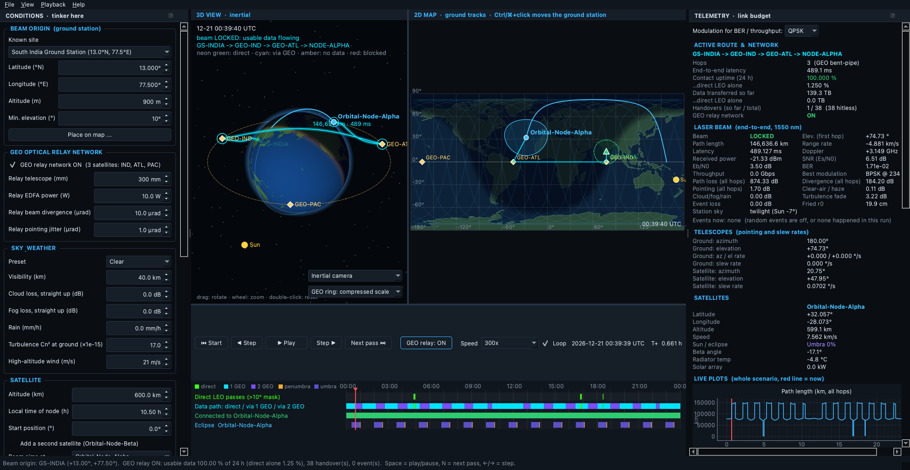

# satSTK — Orbital Mission & Laser Link Simulator

*satSTK* is the mission-analysis companion to [satCAD](https://github.com/Saiaarjay09/satCAD): satCAD designs the spacecraft, satSTK simulates its orbit, eclipses and laser link.

A laser **ground station at one fixed place** (default: **GS-INDIA, 13.0° N, 77.5° E**) sends a **1550 nm beam to a satellite** (**Orbital-Node-Alpha**, a 600 km Sun-synchronous orbital AI datacentre node).
Straight from the ground, a low-Earth satellite is above the horizon for only about **18 minutes a day** from there (1.25 % of the time with usable data). So satSTK 2.0 adds a
**geostationary optical relay network**: three GEO satellites (**GEO-IND**, **GEO-ATL**, **GEO-PAC**) acting as laser "bent pipes", with a router that switches between the direct beam and
2-hop / 3-hop relay paths every few seconds. In clear sky the data link is **up 100 % of the day**; switch the relay OFF (one button) and you see the 1.25 % direct-only figure.

On top of that: a **Conditions panel** to tinker with almost everything (live recompute), weather and turbulence in the atmosphere, and **random and rare events** (birds, aircraft, storms, earthquakes ...).
It runs natively on **macOS and Linux** (and as an app on Windows), needs **no Ansys STK, no licence, no Windows COM, no internet and no account**, and stores nothing unless you export a CSV.

> **What was Orbital-Node-Beta?** A second LEO satellite from the earliest versions. It is now optional: tick *Add a second satellite* in the Conditions panel to get a second target (the beam, and the relay routing, can aim at either), plus a computed crosslink between the two.



*(Screenshot rendered by the app itself with `--screenshot`.)*

## Download the app (no Python needed)

The **Releases** page has a `.dmg` for Apple-silicon Macs (drag satSTK into Applications) and a `-setup.exe` installer for 64-bit Windows 10/11. The apps are
unsigned, so the first launch shows a warning: on a Mac use **System Settings → Privacy & Security → Open Anyway**; on Windows press **More info → Run anyway**.
The macOS app was tested on a real Mac; the Windows installer is built and smoke-tested by GitHub Actions but has not been run on a real PC by the author.

## Run it from source (macOS)

You need Python 3.10 or newer (`python3 --version` to check; get it from python.org if missing). Then, in Terminal, from this folder:

```bash
python3 -m venv venv
```
```bash
source venv/bin/activate
```
```bash
pip install -r requirements.txt
```

and launch the app with the single command:

```bash
python main_app.py
```

Next time you only need `source venv/bin/activate` and `python main_app.py` (or just `./run.sh`, which does all of it for you).
Linux is the same. Windows should work with `venv\Scripts\activate` but has **not been tried**.

## How to use it

1. **Place the beam origin.** On launch a map opens: click where the ground station stands (or pick a known site, including the South India station, or type coordinates) and press **Start simulation**. Later: *File → Place ground station*, or **Ctrl/⌘+click** the 2D map.
2. **Watch it.** Press Play (Space). **Next pass** (N) jumps to just before the next *direct* LEO pass.
3. **Compare architectures.** The **GEO relay: ON/OFF** switch in the transport bar (also a checkbox in the Conditions panel) recomputes everything. Look at *Contact uptime* and *Data transferred* in the telemetry: ON gives 100.000 %, OFF gives the direct-only figure.
4. **Tinker.** The Conditions panel on the left changes the sky, laser, relay terminals, satellite and time; with *Live update* ticked everything recomputes half a second after you stop typing.
5. **Break things.** Tick *Random events on*, slide the frequency (×0.1 to ×1000), *Re-roll* the seed, or open *Choose events / add one by hand*.

## The GEO relay network (new in 2.0)

**The ring.** Three geostationary satellites on the equator (0° inclination, 35,786 km up, one orbit per sidereal day = 23 h 56 min 04 s, so each hangs at a fixed longitude):

| Relay | Longitude | Role |
|---|---|---|
| `GEO-Relay-IND` | 77.5° E | Indian Ocean anchor: directly south of GS-INDIA, **74.7° elevation, 35,976 km, always visible** |
| `GEO-Relay-ATL` | 45° W (315° E) | Atlantic: sees the LEO node when it is over the western hemisphere |
| `GEO-Relay-PAC` | 165° W (195° E) | Pacific: completes global coverage of the 600 km shell |

They are about 120° apart; every pair has a clear line of sight (the beam clears the Earth by more than 10,000 km), and together the three see **every point of the 600 km shell** (checked on 40,000 random positions including the poles); one relay alone sees only about half of it.

**The router.** At every time step it picks a path, in this order of priority:

1. **Direct LEO link** — ground → satellite while the satellite is above the station's mask (10° by default) and carries usable data. Latency a few ms.
2. **2-hop relay** — ground → GEO relay → satellite, when the satellite is below the horizon but a relay can see it (the Indian Ocean relay is used while it can see the satellite). Latency ≈ 240–270 ms.
3. **3-hop relay** — ground → GEO-IND → GEO-ATL *or* GEO-PAC → satellite, when the satellite is on the far side of the Earth from GEO-IND. Latency ≈ 480–510 ms.

Among paths of the same priority the shortest wins; if no path carries data but one exists geometrically it is still chosen and shown as *degraded* (amber). **Make-before-break:** a handover is called *hitless* if the new path was already lit before the old one went dark (or the old one stays lit). In clear sky all handovers are hitless, because GEO-IND is always up. Each handover changes the latency by up to ~500 ms (packets may re-order); the model does not simulate that.

**The link budget on the relay hops.** The relay terminals use **300 mm telescopes, 10 W erbium-doped fibre amplifiers (EDFAs) and narrow 10 µrad beams** (1 µrad pointing jitter), because the hops are 35,000–44,000 km (free-space loss ≈ 289 dB at 36,000 km). Each hop is budgeted separately; the relays are **bent pipes**, so noise is amplified along with the signal and the end-to-end SNR is `1/SNR = Σ 1/SNR_hop` (the weakest hop dominates). The ground hop includes the atmosphere (haze, cloud, turbulence, events), at its own elevation (74.7° for GEO-IND). Doppler uses the rate of change of the whole path.

**What "error-free" means here.** At the default **250 Gbaud** the relay paths close at an SNR of 9–9.6 dB (2 hops, QPSK) and 6.4–6.7 dB (3 hops, BPSK): a *raw* BER of about 1–2×10⁻³, corrected to clean data by the 7 % FEC (modelled as a threshold: usable if the raw BER is below 3.8×10⁻³; no decoder is simulated). If you want the raw BER itself to be negligible, slow down: **at 50 Gbaud, BPSK has a raw BER below 10⁻⁹ on every path** (tested). The GEO relay budget needs the narrow beam — with the LEO terminal's 100 µrad beam it would lose 20 dB.

**What 100 % does and does not mean.** It is 100 % of the time in clear sky with no events: the geometry never blocks every path. It is **not** immune to weather over the ground station (every path starts in the same air: an *Overcast* sky, 25 dB of cloud, takes the relay uptime to ~0 %), nor to satellite-side faults or station-side events (they are applied to every path). A thin cirrus layer, by contrast, barely dents the relay uptime while ruining the direct beam.

## What you see

| Pane | What it shows |
|---|---|
| **3D view** | Shaded globe, orbit, the satellite, the **GEO ring (35,786 km) with the three relays**, the ground station and the active beam path: **neon green = direct LEO pass, bright cyan = via GEO relay(s), amber = on the satellite but no usable data, red dashed = blocked**. A switch chooses **true scale** (GEO at its real distance; the Earth looks small) or **compressed scale** (space above LEO squeezed so LEO and GEO are both easy to inspect: LEO is never distorted; the compressed view is schematic). Drag, wheel, double-click to reset; a drop-down follows a satellite. |
| **2D map** | World map with the terminator, ground tracks, footprints, the station and its elevation-mask circle, the three relay sub-points on the equator, and the active route drawn along the surface. |
| **Timeline** | Rows: direct LEO passes; **data path** (direct / via 1 GEO / via 2 GEO); connected; eclipses; and events (hover for names). Click or drag to jump; Play / Pause / Step / speed 1×–3600×. |
| **Telemetry dock** | **Active route** (e.g. `GS-INDIA -> GEO-IND -> NODE-ALPHA`), hop count, **end-to-end latency**, **contact uptime (24 h)** with and without the relay, **data transferred so far (TB)** with and without, handovers (so far / total, how many hitless), relay ON/OFF; then the end-to-end beam budget and loss breakdown, events happening now, telescope pointing and slew rates, per-satellite state, and live plots (path length, latency, cumulative data, elevation, received power, channel loss, BER, throughput, radiator temperature). |
| **Conditions dock** | Station, **GEO relay network ON/OFF and terminal parameters** (telescope, EDFA power, beam divergence, jitter), weather preset and numbers, satellite, second satellite, laser terminal, time, thermal, random events. |

**File → Export beam data as CSV** saves the time series, including the route at each step. No window? `python main_app.py --headless` prints a summary. Options: `--lat --lon --alt-m --min-elevation --weather Overcast --events --event-seed 3 --event-rate 5 --two-satellites --no-geo-relay --hours --step --csv out.csv`.

```bash
python main_app.py --headless                 # GEO relay ON (default): 100 % usable data in clear sky
```
```bash
python main_app.py --headless --no-geo-relay  # direct passes only: 1.25 % usable data
```

## What is inside (file by file)

| File | Job |
|---|---|
| `orbital_engine.py` | Orbits and geometry: J2 propagator, Sun-synchronous setup, Sun position, frames, ground station and topocentric elevation/azimuth/rates, **GEO relay satellites**, satellite-to-satellite line of sight (Earth ellipsoid + 100 km buffer), Earth shadow, beta angle, radiator temperature and solar-array power. |
| `atmosphere.py` | Clear-air/haze (Kim model, air mass), cloud/fog/rain, Hufnagel-Valley turbulence (Fried parameter, Rytov variance, scintillation fade). |
| `events.py` | 16 seeded random/rare event kinds, manual events, fractional-step application. |
| `laser_link_engine.py` | Single-hop link budget (range, path loss, Gaussian divergence loss, pointing loss, power, SNR, BER for BPSK/QPSK/8PSK/16QAM, throughput, Doppler, slew rates) **plus the multi-hop router**: path candidates, priority selection, cascaded bent-pipe SNR, handovers, uptime and data volume. |
| `simulation.py` | `SimulationConfig` and `run_simulation()` wiring it all together (no GUI code). |
| `main_app.py`, `ui/` | The desktop app, the `--headless` / `--screenshot` / `--selftest` command line, and the Qt widgets. |
| `data/land_110m.json` | Land outlines from Natural Earth (public domain). |
| `tests/` | 153 automated tests (see below). |
| `satstk_app.spec`, `satstk_app.iss` | Packaging (PyInstaller; Inno Setup for the Windows installer). `.github/workflows/app-release.yml` builds both apps and publishes a release when a `v*` tag is pushed. |

Requirements are only `numpy`, `scipy`, `skyfield`, `PySide6-Essentials` and `pyqtgraph`; `requirements-dev.txt` adds `pytest`. The Sun uses a short analytic formula, so **no ephemeris file is ever downloaded**.

## The physics in plain words

* **Orbit.** Gravity plus the Earth's equatorial bulge (J2), integrated numerically. At 97.79° inclination (600 km) J2 turns the orbit plane once a year: *Sun-synchronous*. Default local node time 10:30. The GEO relays are idealised as perfectly fixed points over the equator (real ones hold position with thruster burns).
* **Geometry from the ground.** Azimuth and elevation of every target; the direct beam is usable only above the minimum elevation. Doppler uses velocities relative to the station, which the spinning Earth carries along.
* **Eclipse and thermal.** Sun and Earth are discs seen from the satellite; their overlap gives sunlit / penumbra / umbra, driving solar-array power and the radiator's equilibrium temperature.
* **One hop in space.** The Gaussian beam is `divergence × range` wide at the receiver, which catches the part landing on its aperture. Received power = transmit power × optics × captured fraction × pointing loss. Noise is the quantum limit of a coherent receiver plus a 10 dB implementation penalty. BER uses standard Gray-coded formulas; throughput is the raw rate minus FEC overhead, zero when the raw BER is above the FEC limit.
* **Through the air.** Haze/clear-air loss (more air near the horizon, less from a mountain top), cloud/fog/rain (you set the straight-up loss; it grows as 1/sin(elevation)), turbulence (a 0.1 %-outage fade margin, beam spreading, jitter).
* **Events.** Typical rate per day, duration range, effect (extra dB, total outage, or shaking); seeded Poisson arrivals; events shorter than a time step apply as the fraction of the step they cover.

## Default scenario: what it produces

Start 2026-12-21 00:00 UTC, 24 h, 10 s steps, GS-INDIA (13.0° N, 77.5° E, 900 m), 10° mask, clear sky, no events, 250 Gbaud. From `python main_app.py --headless`:

| | GEO relay ON | GEO relay OFF (direct only) |
|---|---|---|
| Usable data | **100.000 % of the day** | 1.250 % (3 passes, 18 min above the mask) |
| Data delivered (hypothetical terminal) | ≈ 4,244 TB | ≈ 100 TB |
| Time on each path | direct 1.2 %, 2-hop 65.4 %, 3-hop 33.3 % | direct only |
| End-to-end latency | 2.6 ms (direct) · 238–268 ms (2-hop) · 478–503 ms (3-hop) | 2.6–6.4 ms |
| Handovers | 38, all make-before-break (hitless) | – |

(The brief's rule of thumb was "about 1.5 %" for the direct link; this orbit and date give 1.25 %. The relay-to-satellite hop is 35,200–44,300 km, a little wider than the rounded 36,000–41,000 km.)

## Tests

```bash
pip install -r requirements-dev.txt
```
```bash
python -m pytest -q
```

153 tests pass on macOS (Apple Silicon, Python 3.14); 1 is skipped. They check the code against known values rather than against itself: 600 km orbital period (96.69 min), two-body orbit closing after one period and conserving energy, Sun-synchronous inclination (97.79°) and precession (0.9856°/day, both analytically and from the numerical J2 integration), ISS-like westward regression, Sun declination at the solstice/equinox, GMST at J2000, grazing-limit geometry for the 100 km buffer (43.6° / 5185 km), conical vs. cylindrical shadow edges, eclipse duration (35.5 min at β = 0) and its beta-angle dependence, the 66.1° no-eclipse limit, Stefan–Boltzmann radiator temperature, free-space path loss (258.18 dB at 1000 km, 1550 nm), Gaussian capture fraction, agreement between the antenna-gain and beam-spread views, pointing loss against a Monte-Carlo simulation, Q-function and BPSK BER values, the 9-photons-per-bit quantum limit, Doppler of a 7 km/s closing speed (4.516 GHz), ground-station geometry (overhead = 90° and range = altitude, azimuth of N/E/S/W points, horizon distance, analytic az/el rates against finite differences), air mass and Kim visibility values, Hufnagel-Valley Fried parameter and scintillation behaviour, a log-normal fade against Monte Carlo, the ground link budget worked by hand at the peak of a pass, event counts against the Poisson rates over hundreds of seeds, fractional-step event application, and events blocking or splitting a pass in the full simulation; for the GEO relay: the 42,164 km / 35,786 km / 86,164 s orbit (Kepler period check, geostationary speed = ω·r), the three relay longitudes, GEO-IND at 74.7° elevation and 35,976 km from the station, clear GEO-to-GEO lines of sight, 100 % geometric coverage of the 600 km shell by three relays (and about half by one), the 289 dB free-space loss at 36,000 km, the relay hop budget worked by hand (−21.2 dBm), cascaded bent-pipe SNR, routing priorities (direct first, then 1 relay only when it sees the satellite, then 2 relays only when it does not), per-path latencies, path-rate/Doppler against numerical derivatives, make-before-break handovers, 100 % uptime in clear sky vs about 1 % direct-only, an overcast station defeating the relay, a 20 s outage costing exactly 20 s, raw-BER-vs-symbol-rate behaviour, and that nothing in the code imports `comtypes` / `win32com` / any STK package. A GUI smoke test builds the real window offscreen and checks every pane paints. One optional test compares our Sun with Skyfield's DE421 ephemeris and is skipped unless `data/de421.bsp` is present.

GitHub Actions (`.github/workflows/ci.yml`) runs the same tests on Linux and macOS for every push.

## Honest limits — please read

* **Not validated against Ansys STK or any real hardware.** The checks above show the maths is internally correct and matches textbook values; they do not prove agreement with STK's full models.
* Orbit model: J2 only. No atmospheric drag, solar-radiation pressure, Moon/Sun gravity or precession/nutation (the frame is "mean equator of date"). Start elements are treated as osculating, so the real mean altitude differs from 600 km by a few km and the precession rate is within about 2 % of ideal Sun-synchronous.
* Sun position accuracy ≈ 0.01° (seconds of eclipse timing). Earth shadow ignores atmospheric refraction. Eclipse window edges are placed at the nearest time step (± half a step); line-of-sight edges are interpolated.
* The 100 km buffer is modelled as an ellipsoid with both radii grown by 100 km (not an exact offset surface; the difference is well under a kilometre).
* The link budget is a textbook calculation, not a waveform simulation: no laser phase noise, no acquisition/tracking dynamics, no FEC latency; pointing jitter is applied as an average loss. Absolute numbers depend entirely on the parameters you enter (they are placeholders, not a real terminal's specification). The 100 µrad divergence is much wider than a 30 cm telescope's diffraction limit (about 7 µrad), as specified.
* **Atmosphere, weather and turbulence are rules of thumb**, not a validated channel model or a forecast: cloud/fog losses are numbers you set (the presets are round, illustrative values), rain uses a common optical rule (1.076 R^0.67 dB/km over a 2 km layer), turbulence is a Hufnagel-Valley profile with a plane-wave Rytov approximation (a conservative stand-in for an uplink), and the turbulence fade is a 0.1 %-outage margin rather than a time series of flickering. Real sites differ hugely.
* **Events are illustrative.** Their rates, durations and effects are plausible guesses chosen so interesting things happen in a 24 h run, not statistics for any place; the Poisson assumption (independent, constant rate) is a simplification (storms cluster, bird crossings depend on the season and site). Overlapping losses add in dB; an outage is a total loss. Events apply to the beam to the target satellite only (satellite-side events such as safe mode are treated as ground-visible outages).
* The ground station is a point on the WGS-84 ellipsoid with a flat elevation mask: no terrain, buildings or trees, no sun-exclusion angle, no daytime sky-background noise, no uplink/downlink distinction beyond the beam spreading. Only the first pair of satellites' crosslink is computed, and it is reported in the summary but not drawn.
* **GEO relay model assumptions.** Relays are perfectly station-kept points (no drift, no eclipse/power limits, no thermal model), the same point-to-point Gaussian-beam budget is used for every hop, and bent-pipe noise accumulation uses the simple `Σ 1/SNR` rule (real EDFA chains also add amplified spontaneous emission, nonlinear effects and gain ripple). The terminal numbers (300 mm, 10 W, 10 µrad, 1 µrad jitter) are the brief's apertures and power plus my choice of beam width and jitter; the relay-to-satellite hop also assumes the satellite carries an equivalent GEO-facing terminal. Acquisition time, pointing-switch delay, packet re-ordering at handovers, relay-to-relay interference, and sun-in-the-receiver outages are not modelled; a "hitless" handover here means only that a lit alternative existed. Events and weather are applied to every path (they act at the station or on the satellite), so they cut the relay uptime too.
* The thermal model is steady-state (no thermal mass): temperatures jump at eclipse entry/exit. The radiator is a zenith-facing plate with no Earth infrared or albedo.
* The globe is drawn in software (no OpenGL) with a spherical Earth; the map uses a 110 m-resolution coastline. About 15-20 frames per second (the GEO scenes cost a little more) on the author's Mac.
* Tested by the author only on macOS (Apple Silicon, Python 3.14). GitHub's automated tests passed on Linux and macOS for the previous version; the Windows installer is built and smoke-tested by GitHub Actions but has not been run on a real PC.

## Privacy

Nothing leaves your computer and nothing is saved automatically. The only files the app writes are a CSV (or a PNG with `--screenshot`) that *you* ask for.

## What changed from 0.3

The default station is now GS-INDIA (10° mask), the GEO relay network and router are new, the telemetry has route / uptime / data totals, and the globe has the GEO ring with a true/compressed scale switch. Version 2.0.0.

## What changed from 0.1

Version 0.1 was a script that drove Ansys STK through its Windows API and was never run against a real STK. It has been removed entirely (no `comtypes`, no `win32com`, no `agi.stk12`), along with its Windows launcher. Everything it estimated is now computed natively here.

## Credits

Land outlines: [Natural Earth](https://www.naturalearthdata.com/) (public domain). Shadow model after Montenbruck & Gill, *Satellite Orbits*. Sun formula from the Astronomical Almanac.
